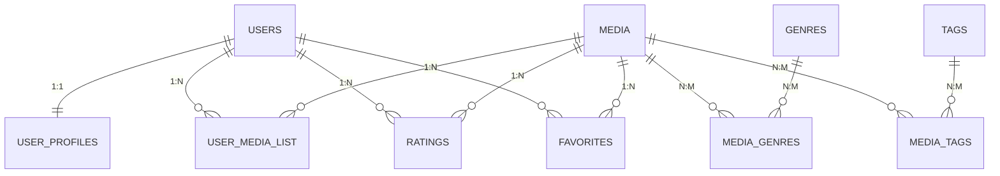

# AniTrack — Anime & Manga Tracker

A full-stack **Java** web application developed as a university project and potential portfolio piece.

AniTrack gives users a shared anime and manga catalog from which they can build a personal library, track their progress, rate titles, pick favorites and view their own statistics. An administrator manages the shared catalog.

> **Project Status:** 🚧 In Progress

---

## 🎮 About the Application

Users can browse the public catalog without an account. After registering, they can add titles to their own list, follow their progress episode by episode or chapter by chapter, and rate what they have watched or read.

The main focus of the project is to build a complete, well-structured web application while practicing relational database design, SQL, a layered Spring Boot backend, and secure authentication and authorization.

The project is intentionally kept at a manageable size: a clean and well-documented core first, extensions afterwards.

---

## ✨ Planned Features

### Accounts & Security
- Registration and login
- Password hashing with BCrypt
- JWT authentication stored in an HttpOnly cookie
- `USER` and `ADMIN` roles
- Ownership checks (users can only modify their own data)

### Catalog
- Anime and manga browsing
- Search and filtering (title, type, genre, year)
- Detailed title pages with genres
- Rating summary calculated from user reactions

### Personal Library
- Personal anime and manga list
- Status tracking (`PLANNING`, `CURRENT`, `COMPLETED`, `PAUSED`, `DROPPED`)
- Progress tracking (episodes / chapters)
- Three-way rating (`NEGATIVE`, `NEUTRAL`, `POSITIVE`)
- Favorites (up to 6)

### Statistics & Profile
- Total titles, episodes watched, chapters read
- Estimated watch time
- Public profile page

### Administration
- Admin interface for the catalog
- Management of genres and tags
- Protected admin endpoints

### Planned Extensions
- Friend search and management
- GitHub-style activity heatmap
- Dark / light / system theme
- Trending, Upcoming and Top 100 lists

---

## 🗄️ Database Design

The database is a normalized PostgreSQL schema written as hand-crafted SQL migrations. Hibernate only validates it, it does not generate it.



| Table | Purpose |
|---|---|
| `users` | user accounts and roles |
| `user_profiles` | profile data (1:1, `user_id` is both PK and FK) |
| `media` | shared anime/manga catalog |
| `genres`, `media_genres` | genres and the N:M join table |
| `tags`, `media_tags` | tags and the N:M join table |
| `user_media_list` | a user's personal list, `UNIQUE(user_id, media_id)` |
| `ratings` | ratings, `UNIQUE(user_id, media_id)` |
| `favorites` | favorites, `UNIQUE(user_id, position)`, `position BETWEEN 1 AND 6` |
| `activity_log` | event log for statistics and the heatmap |
| `friendships` | user connections (planned extension) |

**Database-level safeguards:** primary and foreign keys, `UNIQUE` constraints, `CHECK` constraints (for example the status must match the media type, `progress >= 0`), and `ON DELETE CASCADE` on tables tied to users and media.

Derived values such as rating percentages, popularity and statistics are not stored. They are computed with SQL queries (`JOIN`, `GROUP BY`, `COUNT`, `AVG`, `SUM`).

---

## 🏗️ Architecture

```text
Frontend (HTML / CSS / JS, Bootstrap)
        │  fetch()
        ▼
Controller   →  REST endpoints, input validation
        ▼
Service      →  business logic, authorization and ownership checks
        ▼
Repository   →  Spring Data JPA + native SQL
        ▼
PostgreSQL
```

---

## 🔌 REST API (Planned)

| Area | Endpoints |
|---|---|
| Auth | `POST /api/auth/register`, `POST /api/auth/login`, `POST /api/auth/logout` |
| Catalog | `GET /api/media`, `GET /api/media/{id}` |
| Personal list | `GET/POST /api/user-media`, `PATCH/DELETE /api/user-media/{id}` |
| Ratings | `POST/PATCH/DELETE /api/media/{id}/rating` |
| Favorites | `GET/POST /api/favorites`, `DELETE /api/favorites/{mediaId}` |
| Profile | `GET /api/users/{username}`, `PATCH /api/profile` |
| Statistics | `GET /api/statistics` |
| Admin | `POST/PUT/DELETE /api/admin/media`, `/api/admin/genres` |

Once the application is running, the Swagger UI is available at `http://localhost:8080/swagger-ui.html`.

---

## 🔐 Security

- Passwords are stored only as BCrypt hashes.
- Authentication is **JWT**-based. The token travels in an **HttpOnly, SameSite=Lax cookie**, so JavaScript cannot read it (protection against XSS), and the `SameSite` attribute protects against CSRF.
- Token claims: `sub` (user id), `username`, `role`, `iat`, `exp`. No password or other sensitive data is included.
- `/api/admin/**` endpoints require the `ADMIN` role.
- All input is validated with Jakarta Validation.

---

## 🛠️ Technology

### Backend
- **Java 25**
- **Spring Boot** (Web, Data JPA, Security, Validation)
- Hibernate / JPA with native SQL queries
- MapStruct, Lombok
- springdoc OpenAPI (Swagger UI)

### Database
- **PostgreSQL**
- **Flyway** (versioned SQL migrations)
- pgAdmin 4

### Frontend
- HTML5, CSS3, JavaScript (`fetch`)
- Bootstrap 5

### Tools
- Maven (Maven Wrapper)
- IntelliJ IDEA
- Postman
- Git and GitHub

---

## 📁 Project Structure

The project follows a layered Spring Boot architecture.

```text
src/main/
├── java/hu/anitrack/
│   ├── config/        # security and OpenAPI configuration
│   ├── controller/    # REST endpoints
│   ├── service/       # business logic
│   ├── repository/    # data access
│   ├── entity/        # Java counterparts of the database tables
│   ├── dto/           # request/response objects
│   ├── mapper/        # MapStruct mappers
│   ├── security/      # JWT filter and token service
│   └── exception/     # custom exceptions, global error handling
│
└── resources/
    ├── application.yml
    ├── db/migration/  # Flyway migrations (V1__init.sql, ...)
    └── static/        # frontend files
```

The exact structure may change during development.

---

## 🚧 Development Status

The project is currently **in active development**.

### Current Focus

- [ ] Finalize requirements and data model
- [ ] Create the PostgreSQL schema and seed data
- [ ] Set up the Spring Boot project and database connection
- [ ] Implement entities and repositories
- [ ] Implement native SQL queries
- [ ] Implement the service layer and REST controllers
- [ ] Implement authentication and authorization
- [ ] Build the frontend (catalog, search, personal list, profile)
- [ ] Build the admin interface
- [ ] Testing and documentation
- [ ] Extensions: friends, heatmap, theme

---

## 🎓 Academic Context

This project is being developed as part of the **Programtervező Informatikus BSc** studies at the **University of Debrecen**.

The project serves as a practical exploration of database-driven web development, with particular focus on:

- Relational database design and normalization
- SQL (`SELECT`, `INSERT`, `UPDATE`, `DELETE`, `JOIN`, aggregation)
- Layered software architecture
- REST API design
- Authentication and authorization
- Input validation and error handling
- Software development workflows
- Version control

---

## 📌 Project Goals

The primary goal is to develop a functional, well-structured and well-documented web application that demonstrates the database design and software engineering knowledge acquired during the degree program.

The project is developed iteratively, with the core features first and the extensions afterwards.

---

## 🔀 Git Workflow

Branches: `main`, `develop`, `feature/...`

Commit messages follow a convention:

```text
feat: create media entity
fix: validate media progress
docs: update readme
```

---

## 📷 Screenshots

Screenshots will be added as development progresses.

---

## 👤 Author

**Varga Ferenc Márk**

---

## 📄 License

This project is currently developed as a university/academic project.

Third-party libraries, images and other resources remain subject to their respective licenses.
