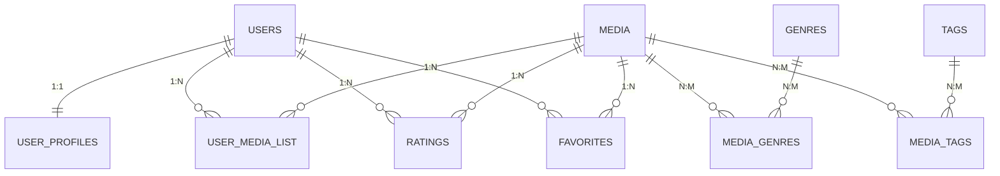

# AniTrack — Anime & Manga Tracker

A full-stack **Java** web application developed as a university project and portfolio piece.

AniTrack gives users a shared anime and manga catalog from which they can build a personal library, track their progress, rate titles, pick favorites and view their own statistics. An administrator manages the shared catalog.

---

## 🎮 About the Application

Users can browse the public catalog without an account. After registering, they can add titles to their own list, follow their progress episode by episode or chapter by chapter, rate what they have watched or read, and see charts about their habits.

The main focus of the project is to build a complete, well-structured web application while practicing relational database design, SQL, a layered Spring Boot backend, and secure authentication and authorization.

The project is intentionally kept at a manageable size: a clean and well-documented core first, extensions afterwards.

---

## ✨ Features

### Accounts & Security
- Registration and login
- Password hashing with BCrypt
- JWT authentication stored in an HttpOnly cookie
- `USER` and `ADMIN` roles
- Ownership checks (users can only modify their own data)

### Catalog
- Anime and manga browsing with cover images
- Search and filtering (title, type, genre, year) with paging
- Detailed title pages with genres, tags and the community rating
- Rating summary calculated from user reactions
- Most popular and top rated rankings

### Personal Library
- Personal anime and manga list
- Status tracking (`PLANNING`, `CURRENT`, `COMPLETED`, `PAUSED`, `DROPPED`)
- Progress tracking (episodes / chapters) with business rules
- Three-way rating (`NEGATIVE`, `NEUTRAL`, `POSITIVE`)
- Favorites (up to 6)

### Statistics
- Total titles, episodes watched, chapters read, estimated watch time
- Charts: list by status, anime vs manga, favorite genres
- Completion rate and recently updated titles

### Administration
- Create, edit and delete titles (the rules for formats, statuses and fields are validated)
- Management of genres and tags
- Admin endpoints protected on the server (`ADMIN` role)

---

## 🚀 Getting Started

### Prerequisites
- JDK 25
- PostgreSQL 18 (pgAdmin 4 is optional)
- Maven (the one bundled with IntelliJ works)

### 1. Create the database

```sql
CREATE DATABASE anitrack;
```

### 2. Add your local configuration

Create `src/main/resources/application-local.yml`. The file is listed in `.gitignore`, so your secrets are never committed.

```yaml
spring:
  datasource:
    password: YOUR_POSTGRES_PASSWORD

app:
  jwt:
    secret: a-long-random-secret-of-at-least-32-characters
```

### 3. Run

Start the application with the `local` profile, for example with the environment variable `SPRING_PROFILES_ACTIVE=local`, or:

```bash
mvn spring-boot:run -Dspring-boot.run.profiles=local
```

Flyway creates the schema and the demo data on the first start. Then open:

- Web application: `http://localhost:8080`
- Swagger UI: `http://localhost:8080/swagger-ui.html`

### Demo accounts (development data only)

| Username | Password | Role |
|---|---|---|
| `admin` | `Admin123!` | ADMIN |
| `tester` | `Test1234!` | USER |
| `alice`, `bob`, `anna`, `peter`, ... | `Test1234!` | USER |

### Tests

```bash
mvn test -Dspring.profiles.active=local
```

The smoke tests run against the local database inside transactions that are rolled back, so the data stays untouched. They expect the original seed data, so if the data was changed by hand, recreate the schema and restart the application.

---

## 🗄️ Database Design

The database is a normalized PostgreSQL schema written as hand-crafted SQL migrations. Hibernate only validates it, it does not generate it.



| Table | Purpose |
|---|---|
| `users` | user accounts and roles |
| `user_profiles` | profile data (1:1, `user_id` is both PK and FK) |
| `media` | shared anime/manga catalog |
| `genres`, `media_genres` | genres and the N:M join table |
| `tags`, `media_tags` | tags and the N:M join table |
| `user_media_list` | a user's personal list, `UNIQUE(user_id, media_id)` |
| `ratings` | ratings, `UNIQUE(user_id, media_id)` |
| `favorites` | favorites, `UNIQUE(user_id, position)`, `position BETWEEN 1 AND 6` |
| `activity_log` | event log, prepared for the activity heatmap (not used yet) |
| `friendships` | user connections, prepared for the friends feature (not used yet) |

**Migrations**

| File | Content |
|---|---|
| `V1__init.sql` | schema: tables, constraints, indexes |
| `V2__seed.sql` | demo users, a first set of titles, lists and ratings |
| `V3__more_seed.sql` | larger demo catalog (61 titles) and more demo users |
| `V4__covers.sql` | cover image URLs, generated by `tools/FetchCovers.java` |

**Database-level safeguards:** primary and foreign keys, `UNIQUE` constraints, `CHECK` constraints (for example the format and status must match the media type, anime and manga have different fields, `progress >= 0`), and `ON DELETE CASCADE` on tables tied to users and media.

Derived values such as rating percentages, popularity and statistics are not stored. They are computed with SQL queries (`JOIN`, `GROUP BY`, `COUNT`, `SUM`, `FILTER`).

---

## 🏗️ Architecture

```text
Frontend (HTML / CSS / JS, Bootstrap, Chart.js)
        │  fetch()
        ▼
Controller   →  REST endpoints, input validation
        ▼
Service      →  business logic, authorization and ownership checks
        ▼
Repository   →  Spring Data JPA + native SQL
        ▼
PostgreSQL
```

---

## 🔌 REST API

| Area | Endpoints | Access |
|---|---|---|
| Auth | `POST /api/auth/register`, `POST /api/auth/login`, `POST /api/auth/logout`, `GET /api/auth/me` | public / logged in |
| Catalog | `GET /api/media` (search, paging), `GET /api/media/{id}`, `GET /api/media/popular`, `GET /api/media/top-rated`, `GET /api/genres`, `GET /api/tags` | public |
| Personal list | `GET/POST /api/me/list`, `PATCH/DELETE /api/me/list/{entryId}` | logged in |
| Ratings | `GET/PUT/DELETE /api/me/ratings/{mediaId}` | logged in |
| Favorites | `GET/POST /api/me/favorites`, `DELETE /api/me/favorites/{mediaId}` | logged in |
| Statistics | `GET /api/me/statistics`, `GET /api/me/statistics/genres` | logged in |
| Admin | `POST/PUT/DELETE /api/admin/media`, `/api/admin/genres`, `/api/admin/tags` | `ADMIN` only |

Everything that belongs to a user lives under `/api/me/**`. The user id is never sent by the client, it always comes from the token.

Error responses use the standard `ProblemDetail` JSON format (`401` not logged in, `403` not allowed, `404` not found, `409` duplicate, `400` validation or business rule).

---

## 🔐 Security

- Passwords are stored only as BCrypt hashes.
- Authentication is **JWT**-based (HS256). The token travels in an **HttpOnly, SameSite=Lax cookie**, so JavaScript cannot read it (protection against XSS). `SameSite=Lax` together with the stateless design is the reason why CSRF tokens are not needed.
- Token claims: `sub` (user id), `username`, `role`, `iat`, `exp` (60 minutes). The token is signed, not encrypted, so it contains no password or other sensitive data.
- Login failures return the same message for an unknown user and a wrong password.
- `/api/admin/**` endpoints require the `ADMIN` role.
- **Ownership checks:** the service layer verifies that a list entry belongs to the logged-in user before changing or deleting it (otherwise `403`).
- All input is validated with Jakarta Validation, and everything shown in the frontend is escaped.

---

## 🛠️ Technology

### Backend
- **Java 25**
- **Spring Boot 4** (Web, Data JPA, Security, Validation)
- Hibernate / JPA with native SQL queries
- MapStruct, Lombok
- springdoc OpenAPI (Swagger UI)

### Database
- **PostgreSQL**
- **Flyway** (versioned SQL migrations)
- pgAdmin 4

### Frontend
- HTML5, CSS3, JavaScript (`fetch`, no build step)
- Bootstrap 5
- Chart.js

### Tools
- Maven
- IntelliJ IDEA
- Postman / Swagger UI
- Git and GitHub

---

## 📁 Project Structure

The project follows a layered Spring Boot architecture.

```text
src/main/
├── java/hu/anitrack/
│   ├── config/        # security and JWT configuration
│   ├── controller/    # REST endpoints
│   ├── service/       # business logic
│   ├── repository/    # data access (+ projections for native queries)
│   ├── entity/        # Java counterparts of the database tables
│   ├── dto/           # request/response objects
│   ├── mapper/        # MapStruct mappers
│   ├── security/      # JWT filter and token service
│   └── exception/     # custom exceptions, global error handling
│
└── resources/
    ├── application.yml
    ├── db/migration/  # Flyway migrations (V1 ... V4)
    └── static/        # frontend files (index.html, css/, js/)

src/test/              # smoke tests for the service layer
tools/                 # FetchCovers.java, the generator of V4__covers.sql
```

---

## 🖼️ Cover Images

The cover URLs in `V4__covers.sql` were collected with `tools/FetchCovers.java` from the public [AniList](https://anilist.co) API. The images are loaded from AniList's servers and remain the property of their respective owners. They are used here for educational purposes only.

---

## 🔭 Future Work

Ideas that were intentionally left out to keep the project at a manageable size:

- Friend search and friend list, public profiles
- GitHub-style activity heatmap (the `activity_log` table is already prepared)
- Dark / light / system theme switch
- Trending, Upcoming and Top 100 lists
- User management in the admin interface
- Refresh tokens and token revocation
- Docker Compose setup and a CI pipeline

---

## 🎓 Academic Context

This project was developed as part of the **Programtervező Informatikus BSc** studies at the **University of Debrecen**.

The project serves as a practical exploration of database-driven web development, with particular focus on:

- Relational database design and normalization
- SQL (`SELECT`, `INSERT`, `UPDATE`, `DELETE`, `JOIN`, aggregation)
- Layered software architecture
- REST API design
- Authentication and authorization
- Input validation and error handling
- Software development workflows
- Version control

---

## 🔀 Git Workflow

Development happens on `main` in small steps. Commit messages follow a convention:

```text
feat: add admin catalog management
fix: validate media progress
docs: update readme
chore: add cover images migration
```

---

## 📷 Screenshots

### Catalog
Search, filters, rankings with cover images.


### Title details
Community rating, personal rating, list and favorites.


### Statistics
Charts about the personal list.


### Admin interface
Managing the catalog (admin role only).


---

## 👤 Author

**Varga Ferenc Márk**

---

## 📄 License

This project is developed as a university/academic project.

Third-party libraries, images and other resources remain subject to their respective licenses.
